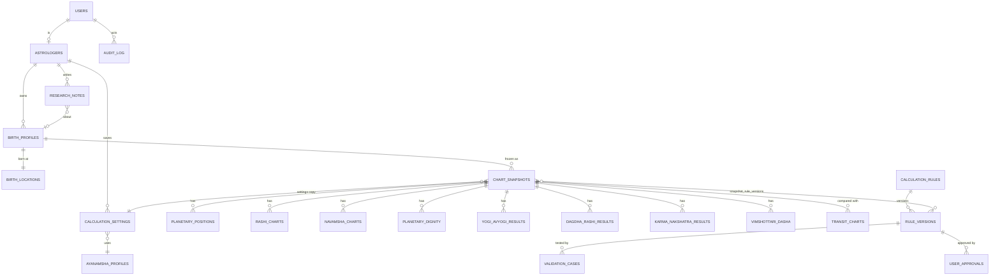

# Deliverable 3 — Entity Relationship Diagram

Render with any Mermaid viewer.

## Table definitions (principal columns)

| Table | Key columns |
|---|---|
| users | id (uuid, = Supabase auth id), email, role, locale, theme, created_at |
| astrologers | id, user_id, display_name, workspace_id, plan |
| birth_profiles | id, astrologer_id, name, gender?, local_date, local_time (with seconds), notes, tags, deleted_at, version |
| birth_locations | id, profile_id, place_label, country, admin1, city, lat, lon, geocoder, tz_id (IANA), utc_offset_sec, dst_active bool, offset_source (`auto`/`manual`), dst_source, manual_reason, utc_instant |
| ayanamsha_profiles | id, code (lahiri, raman, kp, yukteswar, pushya_paksha, fagan_bradley, custom), engine_map jsonb, epoch, is_custom, custom_params jsonb |
| calculation_settings | id, astrologer_id?, ayanamsha_id, node_type (mean/true), house_system, zodiac (sidereal), name_label, version |
| chart_snapshots | id, profile_id, settings_json (full copy), engine_id, engine_version, ephemeris_version, result_hash, frozen_at |
| planetary_positions | snapshot_id, body, lon_deg (numeric), speed, retrograde bool, rashi, nakshatra, pada, house, combust bool |
| rashi_charts / navamsha_charts | snapshot_id, ascendant_lon, ascendant_sign, houses jsonb, (D-9: per-body d9_sign, d9_lon, d9_nak, d9_pada) |
| planetary_dignity | snapshot_id, body, dignity, natural_nature, functional_nature, temp_friend, compound_friend, rule_version_id |
| yogi_avyogi_results | snapshot_id, method_code, yogi_point, yogi_nak, yogi_planet, sahayogi, avyogi_point, avyogi_nak, avyogi_planet, rule_version_id |
| dagdha_rashi_results | snapshot_id, table_code (A/B), tithi_no, paksha, progress, rashis[], houses[], occupants[], lords[], rule_version_id |
| karma_nakshatra_results | snapshot_id, system_code (A/B), reference_rashi, karma_nakshatras[], occupants[], rule_version_id |
| vimshottari_dasha | snapshot_id, level (1-3), parent_id, lord, start_utc, end_utc, year_convention |
| transit_charts | id, snapshot_id, transit_utc, lat, lon, positions jsonb, overlays jsonb |
| research_notes | id, astrologer_id, profile_id?, title, body, language, tsv |
| calculation_rules | id, rule_code (e.g. `YOGI.A`), name, module, description |
| rule_versions | id, rule_id, version, formula_text, source_text, source_ref, inputs, outputs, status (`DRAFT`/`UNVERIFIED`/`APPROVED`/`RETIRED`), effective_from |
| validation_cases | id, rule_version_id, input jsonb, expected jsonb, reference (JHora file/screenshot hash), tolerance, last_result |
| user_approvals | id, rule_version_id, approver_id, decision, comment, decided_at |
| audit_log | id, actor_id, action, entity, entity_id, before_hash, after_hash, at |

## Integrity rules
- `chart_snapshots` rows are insert-only (no UPDATE trigger allowed; "recalculate" creates a new snapshot linked to the old).
- All astrologer-owned tables carry `astrologer_id` (directly or via join) and have RLS policies.
- Longitudes stored as `numeric(12,9)` degrees; no float rounding in storage.
- Deleting a profile is soft-delete, with hard-delete on user data-deletion request.
